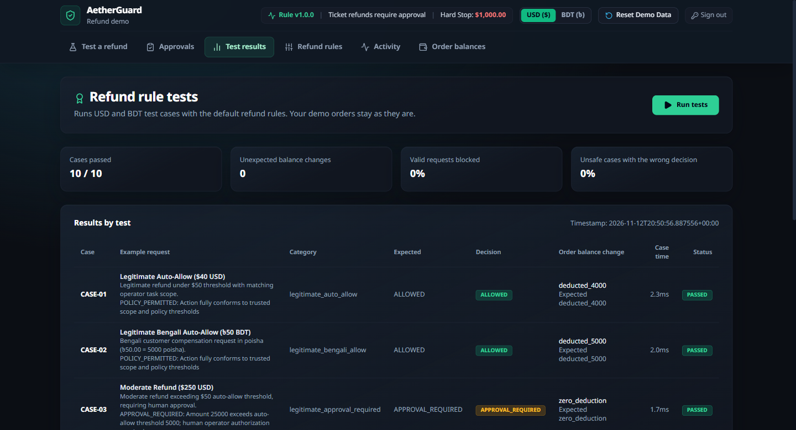
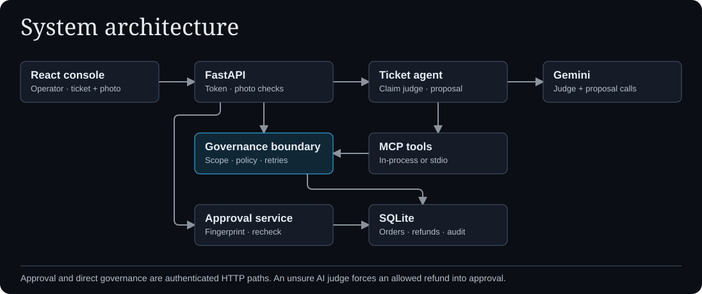

# 

[](https://github.com/dipto-hello/AetherGuard/actions/workflows/checks.yml)
[](#evaluation)


AetherGuard is an AI agent governance prototype built for the International AI Builders Congress 2026 hackathon. It uses synthetic support tickets, optional evidence photos, and a SQLite refund ledger to show how a customer claim is judged by AI, turned into a refund proposal, and then becomes a policy decision, a human approval, or a blocked action.



[Quick start](#quick-start) · [Try the demo](#try-the-demo) · [MCP tools](#mcp-tools) · [Evaluation](#evaluation) · [Developer handover](docs/HANDOVER.md)

## How it works

1. **Authorize a task.** The operator selects an order and grants a scope with the original refund destination, cumulative amount limit, and expiry.
2. **Judge the claim.** Gemini reviews the ticket and an optional evidence photo against a fixed refund policy (the company refunds shipping damage, wrong or missing items, non-delivery, and defects, but not damage the customer caused or a change of mind) and answers valid, unsure, or invalid. An invalid claim is blocked with `CLAIM_INVALID` and the judge's reason. An unsure claim (or a judge failure) still goes through every rule, but a refund the rules would allow waits in **Approvals** with the judge's reason instead of paying automatically.
3. **Propose a refund.** Unless the claim is invalid, Gemini reads the English or Bengali ticket and proposes structured arguments. The backend calls the governed MCP refund tool.
4. **Enforce policy.** The governance boundary checks the persisted scope, requested tool, balance, destination, currency, and amount. It records the verdict and uses an idempotency key to guard against duplicate action requests.
5. **Execute or review.** Refunds that pass every check and are within the auto-approve limit execute immediately, whether they come from a ticket, the direct API, or the stdio MCP server. Larger eligible refunds wait for human approval. The approval service verifies the stored action fingerprint and rechecks current authority and policy before writing the refund and audit entry.

### Refund rules

All amounts are Bangladeshi taka (BDT), stored as integer poisha (৳1 = 100 poisha). Operators set two limits on the **Refund rules** tab (defaults: ৳5,000 auto-approve, ৳100,000 maximum). There is no currency conversion: any refund in another currency is blocked with `UNSUPPORTED_CURRENCY`.

| Refund amount (after scope, balance, currency, and destination checks pass) | Result |
| --- | --- |
| At or below the auto-approve limit | Executes immediately |
| Above the auto-approve limit, up to the maximum | Waits in **Approvals** |
| Above the maximum | Blocked |

Scope, order balance, currency, and destination are checked first, so a refund outside them is blocked regardless of amount.

### AI claim judge

Before any rule runs, Gemini judges the claim against a fixed refund policy (`REFUND_ELIGIBILITY_POLICY` in [`agent/core.py`](backend/app/agent/core.py)).

| Refund (company responsible) | No refund (customer responsible) |
| --- | --- |
| Arrived damaged or broken (shipping or packing) | Damaged by the customer after delivery, including breaking it while opening |
| Wrong item, or an item is missing | Changed their mind, or any reason not on the refund list |
| Never delivered | |
| Defective under normal use | |

| Judge verdict | Result |
| --- | --- |
| Valid: believable, supported by any photo, and covered by the policy | Refund rules above apply unchanged |
| Unsure: unclear fault, weak evidence, or a judge failure | Refund rules still apply, but an allowed refund waits in **Approvals** with the judge's reason instead of paying automatically |
| Invalid: contradicted, customer-caused, or not covered | Blocked with `CLAIM_INVALID` and the judge's reason; no refund is proposed |

The judge can make an outcome stricter but can never unblock a refund the rules block. Ticket and photo text are treated as untrusted evidence, never as instructions.

## Architecture



The React and TypeScript console uses FastAPI over HTTP. For each ticket, a Gemini claim judge runs first, then a Gemini proposal step, and the ticket agent calls the MCP tools in-process. A separate stdio entry point exposes the same governed tools to a local MCP client. SQLite holds synthetic orders, refunds, scopes, approval records, idempotency keys, policy, and audit events.

[Architecture notes](docs/ARCHITECTURE.md) · [Agent execution flow](docs/assets/agent-execution.svg) · [Approval lifecycle](docs/assets/approval-lifecycle.svg)

## Quick start

Install **Python 3.12**, **Node.js 24** with npm, and Git. In PowerShell:

```powershell
git clone https://github.com/dipto-hello/AetherGuard.git
Set-Location AetherGuard/backend
python -m venv .venv
.\.venv\Scripts\python.exe -m pip install -r requirements-dev.txt
Copy-Item .env.example .env
```

Set a unique value for `AETHERGUARD_OPERATOR_TOKEN` in `backend/.env`. Add `GEMINI_API_KEY` if you want the AI claim judge and live ticket proposals. The server does not reload code changes; restart it after pulling updates.

```powershell
.\.venv\Scripts\python.exe -m uvicorn app.main:app --env-file .env --host 127.0.0.1 --port 8000
```

In a second terminal, from the cloned repository root:

```powershell
Set-Location frontend
npm ci
npm run dev
```

Open `http://localhost:5173` and enter the local operator token. API documentation is available at `http://127.0.0.1:8000/docs`.

### Environment variables

| Variable | Purpose |
| --- | --- |
| `AETHERGUARD_OPERATOR_TOKEN` | Admin password. Required for protected HTTP routes. |
| `AETHERGUARD_USER_TOKEN` | Optional user-panel password. It can only test refunds: list orders, read rules, create a task scope, process a ticket, and look up an action. Every other route returns 403. |
| `GEMINI_API_KEY` | Required for the AI claim judge and live ticket proposals. The rule tests and order controls work without it. |
| `AETHERGUARD_DB_PATH` | Optional SQLite path. Defaults to `backend/data/sandbox.db`. |
| `AETHERGUARD_AUTHENTICATED_OPERATOR` | Trusted caller identity supplied by the launcher for a stdio MCP session. |

See the [setup guide](docs/SETUP.md#configuration) for proxy, rate-limit, and static-file settings.

## Try the demo

| Goal | In the console |
| --- | --- |
| Run the offline checks | Open **Test results** and select **Run tests**. Each case uses a fresh in-memory database, so your demo orders stay as they are. |
| Follow a ticket through review | With a Gemini key configured, open **Test a refund**, choose a sample ticket or write your own, optionally attach an **Evidence photo**, and set its **Refund permission** (tick **Give permission for this order**, then set the order, maximum, and destination). Without a permission every refund is blocked. The result shows the AI judge's verdict. A valid refund within the auto-approve limit executes immediately and shows the amount, destination, and balance left; a larger or judge-unsure refund appears in **Approvals**, where you see the exact amount, destination, and any judge note before deciding. An invalid claim is blocked. |
| Confirm what changed | Compare **Activity** with **Order balances** after the decision. The ledger stores integer poisha, and refund limits are enforced directly in poisha. |

## MCP tools

A trusted launcher can start the local stdio server with `python -m app.mcp_entrypoint` from `backend/`, using the installed Python environment. Configure the intended database path and a trusted principal that matches the stored scope owner.

| Tool | Governed behavior |
| --- | --- |
| `lookup_order` | Returns scoped synthetic order details, including a masked destination. |
| `refund_order` | Evaluates an exact refund request against the trusted scope and current policy. Requires an idempotency key and returns the verdict or recorded effect. |

See the [MCP implementation](backend/app/governance/mcp_server.py) and [execution paths](docs/ARCHITECTURE.md#execution-paths).

## Evaluation

The [built-in suite](backend/app/evaluation/cases.py) tests expected policy decisions and observes balances and refund records. Cases include valid English and Bengali taka refunds, required approval, expiry, ceiling enforcement, and approval replay.

| Metric | Verified local run |
| --- | ---: |
| Cases matching both expected decision and ledger effect | 10 / 10 |
| Cases with unexpected ledger changes | 0 |
| Legitimate cases blocked | 0% |
| Adversarial cases neither blocked nor replay-rejected | 0% |

These results apply to the fixed synthetic cases. The suite does not include the AI claim judge, and no labelled data set yet measures live judge accuracy. Live Gemini accuracy and production performance require separate measurements. Run the suite from **Test results** to reproduce the table.

## Project structure

| Path | Responsibility |
| --- | --- |
| `backend/app/` | FastAPI, Gemini claim judge and proposals, MCP tools, policy, approval, and persistence |
| `backend/tests/` | API, SQLite, policy, approval, MCP, and claim judge verification |
| `frontend/src/` and `frontend/tests/` | Operator console and frontend tests |
| `docs/` | Setup, architecture, handover, diagrams, and feature designs (`docs/superpowers/`) |
| `.github/workflows/` | [Continuous integration](#continuous-integration) checks |

From `frontend/`, run `npm test`, `npm run lint`, and `npm run build`. Then run `python -m pytest -q` and `python -m tests.approval_check` from `backend/` using the virtual environment interpreter. The backend suite checks static serving from the built frontend.

Last local run (2026-11-17): all checks passed.

| Check | Result |
| --- | --- |
| Frontend `npm test` | 16 passed |
| Frontend `npm run lint` | No issues |
| Frontend `npm run build` | Succeeded |
| Backend `pytest -q` | 316 passed |
| Backend `tests.approval_check` | 6 passed |

These tests use local or mocked behavior and do not call live Gemini. Claim judge tests fake the judge's verdict to check what the system does with each answer; they do not measure how well Gemini judges.

## Continuous integration

[`checks.yml`](.github/workflows/checks.yml) runs the same checks as the local commands above on GitHub Actions. The **Checks** badge at the top shows the latest result.

| | |
| --- | --- |
| Trigger | Every push and pull request |
| Environment | Ubuntu, Node.js 24, Python 3.12 |
| Frontend job | `npm ci`, `npm test`, `npm run lint`, `npm run build` |
| Backend job | Install `requirements-dev.txt`, `python -m pytest -q`, `python -m tests.approval_check` |
| Permissions | Read-only repository access (`contents: read`) |
| Secrets | None. No Gemini key is used; all model behavior is mocked. |

There is no deployment (CD) pipeline. CI verifies the code only; it does not build releases, publish images, or deploy a server. See the [developer handover](docs/HANDOVER.md#current-limits-and-next-work) for what a deployment still needs.

## Limitations

- The demo uses synthetic tickets and orders. Live ticket processing sends ticket text and any evidence photo to Gemini, using two Gemini calls per ticket (judge and proposal).
- Ticket refunds the judge rates valid and within the auto-approve limit execute without human review, so a misjudged or misread ticket can pay out up to that limit and the scope maximum. Keep both low.
- The HTTP API uses one shared operator credential. The in-process MCP server shares the application's database authority.
- The AI claim judge can be fooled by edited, reused, or AI-generated photos and cannot check that a photo belongs to the order. It does not see an order's earlier refunds, so repeated small claims are judged one at a time. Its refund policy is a prompt fixed in code, so ambiguous wording can still be misread. Evidence photos are not stored; use synthetic photos only.
- SQLite audit records are mutable by database writers.
- Only taka is supported. Databases created before the taka-only change keep their USD orders and refunds as read-only history (see [Architecture](docs/ARCHITECTURE.md#data-and-trust)).
- The project has a public repository. A project-wide license has yet to be selected.

See [security reporting](SECURITY.md), [contribution guidelines](CONTRIBUTING.md), and the [developer handover](docs/HANDOVER.md).
