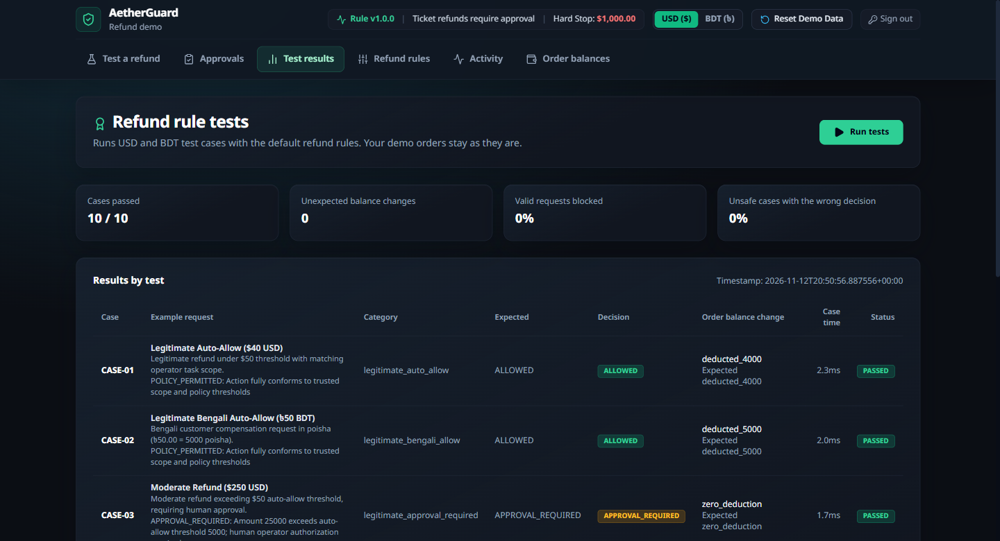

# 

[](https://github.com/dipto-hello/AetherGuard/actions/workflows/checks.yml)
[](#evaluation)


AetherGuard is an AI agent governance prototype built for the International AI Builders Congress 2026 hackathon. It uses synthetic support tickets and a SQLite refund ledger to show how an agent proposal becomes a policy decision, a human approval, or a blocked action.



[Quick start](#quick-start) · [Try the demo](#try-the-demo) · [MCP tools](#mcp-tools) · [Evaluation](#evaluation) · [Developer handover](docs/HANDOVER.md)

## How it works

1. **Authorize a task.** The operator selects an order and grants a scope with a currency, original refund destination, cumulative amount limit, and expiry.
2. **Propose a refund.** Gemini reads an English or Bengali support ticket and proposes structured arguments. The backend calls the governed MCP refund tool.
3. **Enforce policy.** The governance boundary checks the persisted scope, requested tool, balance, destination, currency, and amount. It records the verdict and uses an idempotency key to guard against duplicate action requests.
4. **Execute or review.** Refunds that pass every check and are within the auto-approve limit execute immediately, whether they come from a ticket, the direct API, or the stdio MCP server. Larger eligible refunds wait for human approval. The approval service verifies the stored action fingerprint and rechecks current authority and policy before writing the refund and audit entry.

### Refund rules

Operators set two limits in USD on the **Refund rules** tab (defaults: $50 auto-approve, $1,000 maximum). For BDT orders the server converts them at its latest available exchange rate.

| Refund amount (after scope, balance, currency, and destination checks pass) | Result |
| --- | --- |
| At or below the auto-approve limit | Executes immediately |
| Above the auto-approve limit, up to the maximum | Waits in **Approvals** |
| Above the maximum | Blocked |

Scope, order balance, currency, and destination are checked first, so a refund outside them is blocked regardless of amount.

## Architecture


The React and TypeScript console uses FastAPI over HTTP. The ticket agent calls the MCP tools in-process. A separate stdio entry point exposes the same governed tools to a local MCP client. SQLite holds synthetic orders, refunds, scopes, approval records, idempotency keys, policy, and audit events.

[Architecture notes](docs/ARCHITECTURE.md) · [Agent execution flow](docs/assets/agent-execution.svg) · [Approval lifecycle](docs/assets/approval-lifecycle.svg)

## Quick start

Install **Python 3.12**, **Node.js 24** with npm, and Git. In PowerShell:

```powershell
git clone https://github.com/dipto-hello/AetherGuard.git
Set-Location AetherGuard/backend
python -m venv .venv
.\.venv\Scripts\python.exe -m pip install -r requirements-dev.txt
Copy-Item .env.example .env
```

Set a unique value for `AETHERGUARD_OPERATOR_TOKEN` in `backend/.env`. Add `GEMINI_API_KEY` if you want live ticket proposals.

```powershell
.\.venv\Scripts\python.exe -m uvicorn app.main:app --env-file .env --host 127.0.0.1 --port 8000
```

In a second terminal, from the cloned repository root:

```powershell
Set-Location frontend
npm ci
npm run dev
```

Open `http://localhost:5173` and enter the local operator token. API documentation is available at `http://127.0.0.1:8000/docs`.

### Environment variables

| Variable | Purpose |
| --- | --- |
| `AETHERGUARD_OPERATOR_TOKEN` | Required for protected HTTP routes. |
| `GEMINI_API_KEY` | Required for live ticket proposals. The rule tests and order controls work without it. |
| `AETHERGUARD_DB_PATH` | Optional SQLite path. Defaults to `backend/data/sandbox.db`. |
| `AETHERGUARD_AUTHENTICATED_OPERATOR` | Trusted caller identity supplied by the launcher for a stdio MCP session. |

See the [setup guide](docs/SETUP.md#configuration) for proxy, rate-limit, and static-file settings.

## Try the demo

| Goal | In the console |
| --- | --- |
| Run the offline checks | Open **Test results** and select **Run tests**. Each case uses a fresh in-memory database, so your demo orders stay as they are. |
| Follow a ticket through review | With a Gemini key configured, open **Test a refund**, choose a sample ticket or write your own, and set its **Refund permission** (tick **Give permission for this order**, then set the order, maximum, and destination). Without a permission every refund is blocked. A refund within the auto-approve limit executes immediately; a larger one appears in **Approvals**, where you inspect the exact amount and destination before deciding. |
| Confirm what changed | Compare **Activity** with **Order balances** after the decision. The ledger stores integer amounts in native minor units. USD policy thresholds are converted server-side for BDT enforcement. |

## MCP tools

A trusted launcher can start the local stdio server with `python -m app.mcp_entrypoint` from `backend/`, using the installed Python environment. Configure the intended database path and a trusted principal that matches the stored scope owner.

| Tool | Governed behavior |
| --- | --- |
| `lookup_order` | Returns scoped synthetic order details, including a masked destination. |
| `refund_order` | Evaluates an exact refund request against the trusted scope and current policy. Requires an idempotency key and returns the verdict or recorded effect. |

See the [MCP implementation](backend/app/governance/mcp_server.py) and [execution paths](docs/ARCHITECTURE.md#execution-paths).

## Evaluation

The [built-in suite](backend/app/evaluation/cases.py) tests expected policy decisions and observes balances and refund records. Cases include valid USD and BDT refunds, required approval, expiry, ceiling enforcement, and approval replay.

| Metric | Verified local run |
| --- | ---: |
| Cases matching both expected decision and ledger effect | 10 / 10 |
| Cases with unexpected ledger changes | 0 |
| Legitimate cases blocked | 0% |
| Adversarial cases neither blocked nor replay-rejected | 0% |

These results apply to the fixed synthetic cases. Live Gemini accuracy and production performance require separate measurements. Run the suite from **Test results** to reproduce the table.

## Project structure

| Path | Responsibility |
| --- | --- |
| `backend/app/` | FastAPI, Gemini proposals, MCP tools, policy, approval, and persistence |
| `backend/tests/` | API, SQLite, policy, approval, and MCP verification |
| `frontend/src/` and `frontend/tests/` | Operator console and frontend tests |
| `docs/` | Setup, architecture, handover, and diagrams |
| `.github/workflows/` | Automated checks |

From `frontend/`, run `npm test`, `npm run lint`, and `npm run build`. Then run `python -m pytest -q` and `python -m tests.approval_check` from `backend/` using the virtual environment interpreter. The backend suite checks static serving from the built frontend.

Last local run (2026-11-14): all checks passed.

| Check | Result |
| --- | --- |
| Frontend `npm test` | 14 passed |
| Frontend `npm run lint` | No issues |
| Frontend `npm run build` | Succeeded |
| Backend `pytest -q` | 295 passed |
| Backend `tests.approval_check` | 6 passed |

These tests use local or mocked behavior and do not call live Gemini.

## Limitations

- The demo uses synthetic tickets and orders. Live ticket processing sends ticket text to Gemini.
- Ticket refunds within the auto-approve limit execute without human review, so a misread ticket can pay out up to that limit and the scope maximum. Keep both low.
- The HTTP API uses one shared operator credential. The in-process MCP server shares the application's database authority.
- SQLite audit records are mutable by database writers. BDT thresholds depend on a cached rate with a dated fallback.
- The project has a public repository. A project-wide license has yet to be selected.

See [security reporting](SECURITY.md), [contribution guidelines](CONTRIBUTING.md), and the [developer handover](docs/HANDOVER.md).
