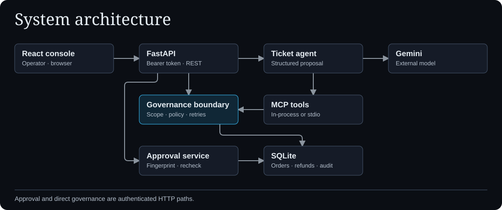

# AetherGuard

AetherGuard is a governance prototype for AI agents that propose consequential tool actions. Its hackathon demo uses synthetic customer support tickets and a refund ledger so operators can see what was proposed, which rules applied, and what actually executed.

## What you can try

- Create an order-bound task scope with an expiry, currency, original destination, and cumulative refund limit.
- Submit an English or Bengali ticket for a Gemini proposal. Review a valid proposed refund before it changes the synthetic balance.
- Inspect policy verdicts, pending approvals, recorded actions, refund history, and the isolated evaluation matrix.
- Connect a local MCP client over stdio to the governed order lookup and refund tools.

## How a refund moves through the system

The React and TypeScript console calls the FastAPI API. The operator grants scope through the authenticated API. Gemini proposes structured arguments and the backend invokes the governed MCP tool. The policy engine checks the persisted scope, tool, currency, destination, amount, and available balance. USD policy thresholds are translated server-side for BDT, while ledger values remain in native minor units.

The boundary can block an action, execute an eligible direct request, or record a pending approval. Ticket refunds always require review. Approval reloads the exact action, verifies its fingerprint, and rechecks current scope, policy, and budget before updating the synthetic ledger in SQLite. See the [execution flow](docs/assets/agent-execution.svg) and [approval lifecycle](docs/assets/approval-lifecycle.svg).

## Run locally

Use Python 3.12 and Node.js 24 with npm. Follow the [setup guide](docs/SETUP.md) to install dependencies, configure a local operator token, and start FastAPI and Vite. A Gemini API key is required for live ticket proposals. The evaluation suite and synthetic order controls can be used without a key.

From `frontend/`, run `npm test`, `npm run lint`, and `npm run build` (including TypeScript checking). Then run `python -m pytest -q` from `backend/` so the static-serving tests can use the built frontend.

## Repository guide

| Location | Purpose |
| --- | --- |
| `backend/app/` | API, agent, MCP tools, policy, approval, and SQLite persistence |
| `backend/tests/` | API, policy, approval, persistence, and MCP tests |
| `frontend/src/` and `frontend/tests/` | Operator console and frontend tests |
| `docs/` | Setup, architecture, handover, and editable SVG figures |
| `.github/workflows/` | Backend and frontend verification |

The API uses one shared bearer credential. The in-process MCP path shares the backend's database authority, and SQLite audit records are mutable by anyone with write access to the database. This prototype handles synthetic data only. See [Security](SECURITY.md), [Architecture](docs/ARCHITECTURE.md), [Developer handover](docs/HANDOVER.md), and [Contributing](CONTRIBUTING.md).
