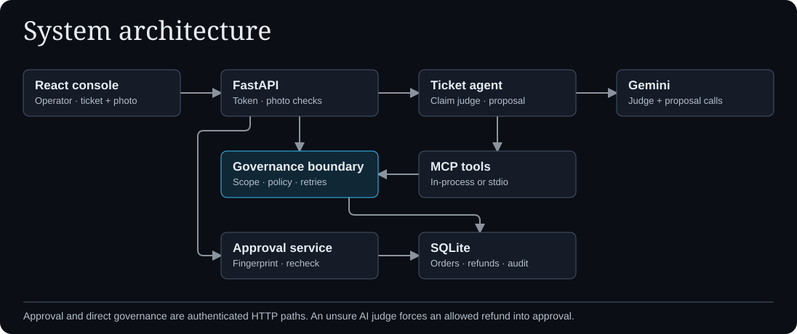
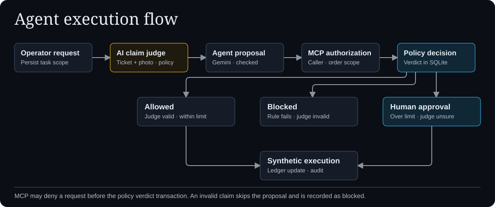
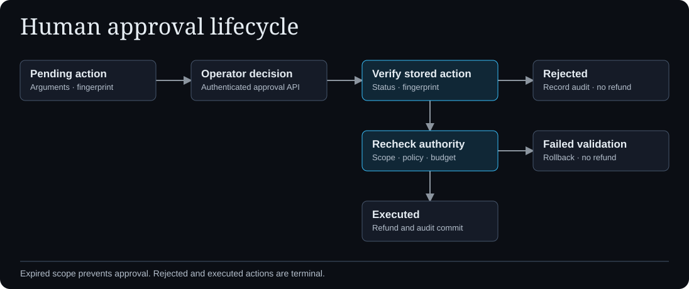

# Architecture

The React console uses relative HTTP API paths. FastAPI applies a shared operator bearer-token check to protected API routes. The server stores the trusted scope and fixes the HTTP scope owner to the demo principal. A ticket and its model output supply proposed arguments.

## Execution paths

- **Ticket processing** — `api/agent.py` retrieves persisted scope and calls `agent/core.py`. A Gemini claim judge first reviews the ticket and any evidence photo; an invalid judgment skips the proposal and records a blocked `CLAIM_INVALID` attempt, and an unsure judgment forces any refund the rules allow into human approval. The Gemini SDK then proposes structured arguments. The agent checks proposal consistency, then calls the in-process MCP server. Refunds within the auto-approve limit execute immediately; larger eligible refunds wait for approval. Its scoped order enrichment uses a direct database read after order and expiry checks.
- **Direct governance** — `api/governance.py` invokes `GovernanceBoundary` directly for authenticated API requests. The stdio entry point uses the MCP tool wrapper, which binds the caller through trusted launcher configuration and checks scope ownership.
- **Policy and persistence** — `governance/boundary.py` records idempotency, reloads persisted scope, evaluates the tool and arguments, enforces the cumulative budget, and records a verdict. It writes pending approvals or executes eligible refunds within the SQLite transaction. Some MCP wrapper denials occur before that transaction.
- **Evaluation** — `evaluation/runner.py` exercises synthetic cases in a separate in-memory database. Its outcomes measure those cases and do not measure live-model accuracy.

## Approval

`approval/service.py` verifies the stored action fingerprint and pending status. Approval reloads the active scope and current order and policy, checks the cumulative budget, then records execution and audit state in one transaction. Rejection records a terminal decision without a refund. A failed check leaves the transaction uncommitted. Scope expiry prevents execution, and schema upgrades may explicitly expire legacy pending rows.

## Data and trust

`sandbox/db.py` defines the schema and applies initialization and compatibility migrations. `orders` and `refunds` hold the synthetic ledger. `task_scopes`, `pending_actions`, `action_requests`, `policy_config`, and `audit_events` track authority, idempotency, configuration, and outcomes. `schema_migrations` tracks compatibility upgrades. SQLite connections enable foreign keys, and file databases use WAL. The ledger is taka only: refund amounts and policy limits are integer poisha, compared directly with no currency conversion, and any non-BDT refund is blocked with `UNSUPPORTED_CURRENCY`.

The one-time `bdt_only` migration upgrades databases created when USD was supported. It keeps USD orders and refunds unchanged as history; they stay visible but cannot be refunded, because policy only accepts BDT. It expires USD task scopes and pending actions that are not BDT. Policy limits were stored in USD cents: the old defaults ($50 / $1,000) become the new defaults (৳5,000 / ৳100,000), and custom limits are converted once at the last dated reference rate (৳124.42 per $1, 10 Nov 2026), rounded down. Back up the database before upgrading, and use **Reset Data** to reseed the taka sample orders.

The HTTP token and MCP process identity are demo trust boundaries. The in-process MCP client, tool server, and SQLite access share process authority. See [Security](../SECURITY.md) before expanding the trust model.
