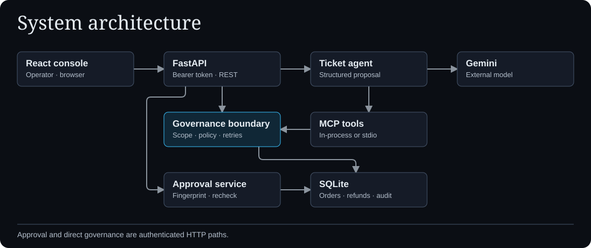
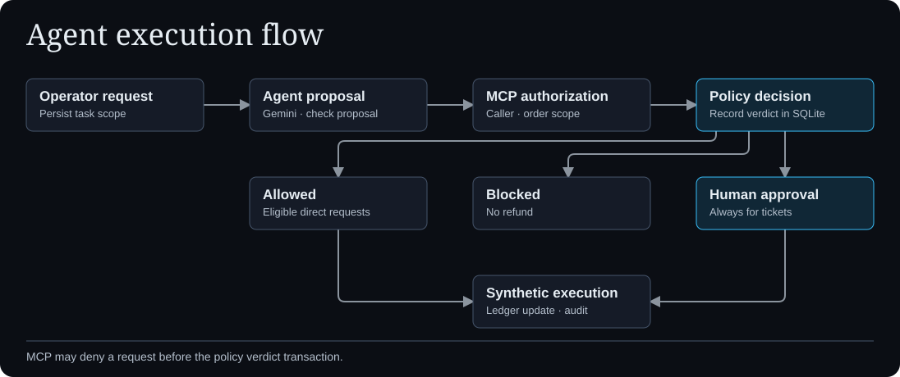
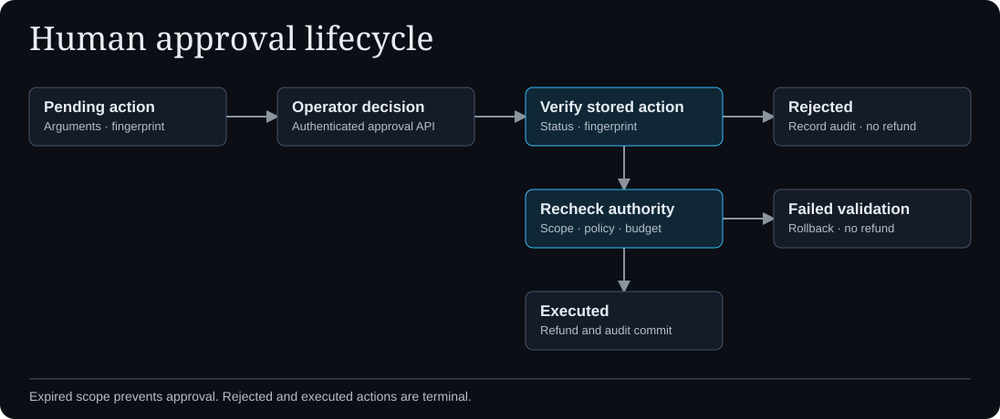

# Architecture

The React console uses relative HTTP API paths. FastAPI applies a shared operator bearer-token check to protected API routes. The server stores the trusted scope and fixes the HTTP scope owner to the demo principal. A ticket and its model output supply proposed arguments.

## Execution paths

- **Ticket processing** — `api/agent.py` retrieves persisted scope and calls `agent/core.py`. The Gemini SDK proposes structured arguments. The agent checks proposal consistency, then calls the in-process MCP server with mandatory refund approval. Its scoped order enrichment uses a direct database read after order and expiry checks.
- **Direct governance** — `api/governance.py` invokes `GovernanceBoundary` directly for authenticated API requests. The stdio entry point uses the MCP tool wrapper, which binds the caller through trusted launcher configuration and checks scope ownership.
- **Policy and persistence** — `governance/boundary.py` records idempotency, reloads persisted scope, evaluates the tool and arguments, enforces the cumulative budget, and records a verdict. It writes pending approvals or executes eligible refunds within the SQLite transaction. Some MCP wrapper denials occur before that transaction.
- **Evaluation** — `evaluation/runner.py` exercises synthetic cases in a separate in-memory database. Its outcomes measure those cases and do not measure live-model accuracy.

## Approval

`approval/service.py` verifies the stored action fingerprint and pending status. Approval reloads the active scope and current order and policy, checks the cumulative budget, then records execution and audit state in one transaction. Rejection records a terminal decision without a refund. A failed check leaves the transaction uncommitted. Scope expiry prevents execution, and schema upgrades may explicitly expire legacy pending rows.

## Data and trust

`sandbox/db.py` defines the schema and applies initialization and compatibility migrations. `orders` and `refunds` hold the synthetic ledger. `task_scopes`, `pending_actions`, `action_requests`, `policy_config`, and `audit_events` track authority, idempotency, configuration, and outcomes. `schema_migrations` tracks compatibility upgrades. SQLite connections enable foreign keys, and file databases use WAL. Refund amounts are integers in native minor units. USD-cent policy limits are compared to BDT using a cached public rate with a dated reference fallback.

The HTTP token and MCP process identity are demo trust boundaries. The in-process MCP client, tool server, and SQLite access share process authority. See [Security](../SECURITY.md) before expanding the trust model.
