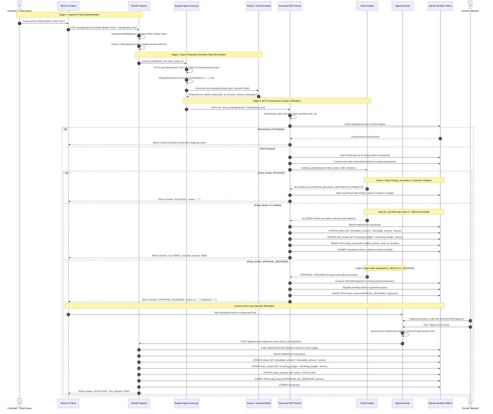

# AetherGuard — Governed Refund Execution Flow

## 1. Overview

This document specifies the exact lifecycle of a support-ticket refund request as it progresses from unstructured user input through the probabilistic agent boundary, into the deterministic governance firewall, and finally to atomic execution and audit trail recording.

---

## 2. Governed Refund Execution Flow Diagram



---

## 3. Decision Branch Matrix & Reason Codes

The deterministic policy engine branches across three distinct outcomes based on mathematical and cryptographic invariants:

| Outcome | Trigger Condition | System Action | Sandbox Effect |
| :--- | :--- | :--- | :--- |
| **ALLOWED** | $\text{Amount} \le \text{Auto-Allow Threshold}$ ($50.00)<br>$\land \text{Amount} \le \text{Order Balance}$<br>$\land \text{Destination} == \text{Original Payment}$<br>$\land \text{Currency} == \text{Order Currency}$<br>$\land \text{Scope Active \& Budget Sufficient}$ | Instantly executed via MCP tool. | `refundable_amount` atomically reduced; audit event committed. |
| **APPROVAL_REQUIRED** | $\text{Amount} > \text{Auto-Allow Threshold}$ ($50.00)<br>$\land \text{Amount} \le \text{Hard Ceiling}$ ($1,000.00)<br>$\land \text{Amount} \le \text{Order Balance}$<br>$\land \text{Destination Valid}$<br>$\land \text{Scope Active \& Budget Sufficient}$ | Action suspended and quarantined. Action registered in SQLite with SHA-256 fingerprint. | `$0` deducted until human operator reviews and explicitly approves. |
| **BLOCKED** | Any of the following:<br>• $\text{Amount} > \text{Order Balance}$ (`EXCEEDS_ORDER_BALANCE`)<br>• $\text{Amount} > \text{Hard Ceiling}$ (`EXCEEDS_HARD_CEILING`)<br>• $\text{Destination} \ne \text{Original Destination}$ (`DESTINATION_MISMATCH`)<br>• $\text{Currency} \ne \text{Order Currency}$ (`CURRENCY_MISMATCH`)<br>• Remaining Scope Budget insufficient (`SCOPE_BUDGET_EXCEEDED`)<br>• Scope expired or inactive (`SCOPE_EXPIRED`)<br>• Malformed / negative amount (`INVALID_AMOUNT`) | Action halted immediately. | `$0` deducted. Immutable `BLOCKED` audit log event written. |

---

## 4. Concurrency, Race Condition, & Fail-Closed Guards

### 4.1 In-Flight UI Double-Click Lock
In `frontend/src/components/ApprovalDesk.tsx`, when an operator clicks **"Approve & Execute"** or **"Reject"**, a synchronous in-flight reference lock (`isSubmittingRef`) is acquired immediately before any async dispatch. Any rapid subsequent clicks within the same microtask or rendering cycle are silently dropped, preventing multi-click race conditions from dispatching duplicate approval requests.

### 4.2 Database Concurrency (`BEGIN IMMEDIATE`)
SQLite default transactions (`BEGIN DEFERRED`) allow multiple writers to acquire read locks simultaneously, upgrading to write locks only when an `UPDATE` executes. Under high concurrency, this produces `SQLITE_BUSY` or phantom overdraws. AetherGuard enforces `BEGIN IMMEDIATE` at transaction start, reserving an exclusive write lock upfront and serializing concurrent refunds against the same order or scope budget.

### 4.3 Fail-Closed Audit Trail (INV-10)
In `backend/app/governance/mcp_server.py`, the order deduction and audit event creation occur inside the same atomic database transaction. If the audit logging write raises an exception (e.g. disk full, schema failure, or constraint violation), the transaction is immediately rolled back:
```python
try:
    cursor.execute("UPDATE orders SET refundable_amount = refundable_amount - ?", (amount,))
    cursor.execute("INSERT INTO audit_events (...) VALUES (...)")
    conn.commit()
except Exception as exc:
    conn.rollback()
    raise AuditWriteFailureError("Transaction rolled back to prevent untracked balance change") from exc
```
This guarantees that **no financial balance change can ever exist without a corresponding immutable audit trail record**.
