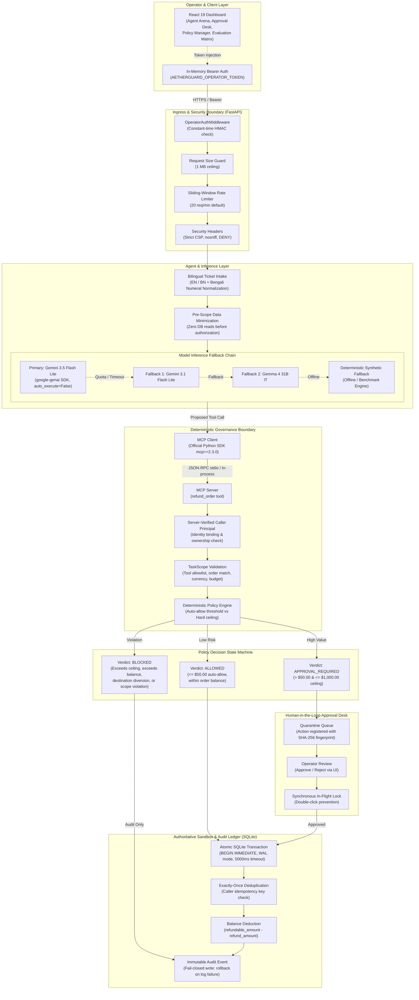

# AetherGuard — System Architecture Specification

## 1. Overview & Architectural Philosophy

AetherGuard is an **in-line, zero-trust execution firewall and governance boundary** for autonomous AI agents using the Model Context Protocol (MCP).

Traditional AgentOps platforms operate as **passive telemetry observers** ("the autopsy pattern")—they log agent behavior after tool calls execute. If an agent suffers from prompt injection, excessive agency (OWASP LLM06), or hallucination, an unconstrained write tool can siphon funds, corrupt customer records, or violate operational limits before any alert fires.

AetherGuard enforces a **strict dual-boundary model**:
1. **The Probabilistic Agent Boundary**: The LLM (Google Gemini / Gemma or deterministic synthetic fallback) is treated as an untrusted parameter extractor. It possesses zero direct database access, zero write credentials, and no authority to execute tools independently.
2. **The Deterministic Governance Boundary**: All proposed actions are intercepted by a deterministic Python/SQLite policy engine that verifies operator-granted task scopes, budget ceilings, order balance constraints, and caller identity before any database transaction can begin.

```
+----------------------------------------------------------------------------------------------------+
|                                    PROBABILISTIC BOUNDARY (UNTRUSTED)                              |
|   Customer Ticket  ──>  Support Agent (Bilingual)  ──>  LLM Parameter Extraction (Gemini / Gemma)  |
+----------------------------------------------------------------------------------------------------+
                                                  │
                                   Untrusted Action Proposal
                                                  ▼
+----------------------------------------------------------------------------------------------------+
|                                  DETERMINISTIC BOUNDARY (TRUSTED)                                  |
|   Caller Auth  ──>  Pre-Scope Protection  ──>  Policy Evaluation  ──>  Human Approval (Quarantine)    |
|                                                     │                                              |
|                                                     ▼                                              |
|                                      Atomic Execution & SQLite Ledger                              |
+----------------------------------------------------------------------------------------------------+
```

---

## 2. End-to-End System Architecture Diagram



---

## 3. Subsystem Breakdown & Trust Boundaries

### 3.1 Operator & Client Layer
- **Technology**: React 19 SPA, TypeScript, Tailwind CSS, Vite.
- **Security Posture**: The operator token is held exclusively in browser memory (React state) and is never persisted to `localStorage`, `sessionStorage`, or cookies. 
- **Key Views**:
  - `AgentArena`: Ticket input, bilingual language detection, 5-stage live execution trace.
  - `ApprovalDesk`: Quarantined high-value transactions with parameter diffs, SHA-256 fingerprints, and double-click race defense.
  - `PolicyManager`: Live policy threshold inspection (auto-allow ceiling, maximum transaction limit).
  - `AuditLedger`: Comprehensive chronological event log with verdict, reason, and timestamps.
  - `SandboxViewer`: Direct visibility into synthetic database orders and customer payment records.
  - `EvaluationMatrix`: Deterministic 10-case benchmark suite execution and metric telemetry.

### 3.2 Ingress & Security Boundary (FastAPI)
- **Technology**: FastAPI 0.115+, Uvicorn, Python 3.12.
- **Operator Authentication**: `OperatorAuthMiddleware` intercepts all requests to `/api/*` (except public health check `/api/health`). It uses `hmac.compare_digest` to perform constant-time token comparison against the server-side `AETHERGUARD_OPERATOR_TOKEN`.
- **Payload Size Ceiling**: Enforces a strict 1 MB maximum request body limit (`MAX_REQUEST_SIZE = 1_048_576`). Rejects oversized payloads with HTTP 413.
- **Sliding-Window Rate Limiting**: Implements a sliding-window rate limiter (default: 20 RPM) on ticket processing endpoints to mitigate automated abuse.
- **Security Headers**: Injects `Content-Security-Policy`, `X-Content-Type-Options: nosniff`, `X-Frame-Options: DENY`, `Referrer-Policy: no-referrer`, and `Cache-Control: no-store` on all API responses.

### 3.3 Support Agent & Pre-Scope Protection (`core.py`)
- **Bilingual Processing**: Supports English and Bengali ticket syntax, including automatic Bengali numeral normalization (`০-৯` to `0-9`).
- **Sensitive Data Minimization & Pre-Scope Decoupling**: The agent code **strictly forbids database reads** before scope authorization. Ticket parsing relies exclusively on client input; order balance retrieval and destination enrichment are deferred until after the deterministic boundary verifies caller authority.
- **LLM Fallback Architecture**:
  1. `gemini-3.5-flash-lite`: Primary multimodal model (15 RPM / 500 RPD free tier).
  2. `gemini-3.1-flash-lite`: First fallback model for quota exhaustion or provider errors.
  3. `gemma-4-31b-it`: High-throughput secondary text model fallback.
  4. `deterministic_synthetic`: Offline heuristic parser ensuring 100% testability and zero-dependency execution.
- **Tool Proposal Guard**: Automatic function calling execution is disabled (`auto_execute=False`). The LLM only proposes a structured tool call schema; execution is delegated to the governed MCP boundary.

### 3.4 MCP Protocol & Identity Binding (`mcp_server.py`)
- **Technology**: Official Python Model Context Protocol SDK (`mcp==2.3.0`).
- **Trusted Principal Binding**: Client-provided `caller_id` arguments in tool calls are strictly treated as untrusted metadata. The server derives caller identity directly from authenticated session context.
- **Tool Contract**: Exposes `refund_order(order_id, amount, currency, destination, idempotency_key)`.
- **Data Minimization on Read**: `lookup_order` strips customer names and raw payment card tokens, returning only masked identifiers (`card...4242`).

### 3.5 Deterministic Governance Boundary & Policy Engine
- **Task Scope (`TaskScope`)**: Represents granular, time-bound operator authorization:
  - Allowed tools (e.g. `["refund_order"]`).
  - Target orders, allowed currencies, and destination whitelist.
  - Cumulative spending budget: tracks remaining allocated budget across transactions.
- **Policy Rules (`PolicyRule`)**:
  - `auto_allow_threshold`: Upper limit for instant execution (default: `$50.00` / 5,000 minor units).
  - `hard_ceiling`: Maximum allowable single transaction under any circumstance (default: `$1,000.00` / 100,000 minor units).
- **Decision Engine (`evaluate_policy`)**: Pure, side-effect-free function evaluating proposed parameters against scope, order status, and policy rules.

### 3.6 Authoritative Sandbox & Audit Ledger (SQLite)
- **Concurrency & Persistence**: Embedded SQLite using Write-Ahead Logging (`PRAGMA journal_mode=WAL`), immediate transaction locking (`BEGIN IMMEDIATE`), and a 5,000ms busy timeout.
- **Idempotency Guarantee**: All actions require a unique caller-supplied idempotency key (max 128 chars). Re-submitting the same key returns the existing outcome without double-deduction.
- **Fail-Closed Audit Invariant**: If recording an audit log event fails (e.g. disk failure or lock contention), the active database transaction immediately rolls back, ensuring zero untracked financial deductions.

---

## 4. Security Invariant Matrix (INV-01 to INV-12)

The architecture is formally validated against 12 core security invariants:

| Invariant | Title | Enforcement Layer | Verification Mechanism |
| :--- | :--- | :--- | :--- |
| **INV-01** | Order Balance Ceiling | Policy Engine & SQLite | Automated pytest asserting `$0` deducted when refund > refundable balance. |
| **INV-02** | Atomic Cumulative Budget | Policy Storage & DB | Concurrent multi-threaded requests serialized via `BEGIN IMMEDIATE`. |
| **INV-03** | Exactly-Once Idempotency | DB Action Registry | Repeated identical idempotency keys return cached verdict with zero duplicate write. |
| **INV-04** | Deterministic Authentication | `OperatorAuthMiddleware` | Constant-time HMAC verification; rejects invalid or missing tokens. |
| **INV-05** | Approval Parameter Binding | Approval Desk & DB | SHA-256 fingerprint generated at quarantine; verified bit-for-bit at execution. |
| **INV-06** | Fail-Closed on Fault | LLM & Engine | Timeouts, quota exhaustion, or unparseable inputs return amount 0 and `BLOCKED`. |
| **INV-07** | Currency Match | Policy Engine | Currency must strictly match order and scope currency (e.g. USD vs BDT). |
| **INV-08** | Destination Protection | Policy Engine | Diverted destination accounts (unauthorized card or crypto wallet) blocked instantly. |
| **INV-09** | Pre-Scope Minimization | Support Agent | Zero database reads prior to verified task scope possession. |
| **INV-10** | Zero-Leakage Audit Trail | MCP Server & DB | Database transaction rolls back if audit log insert encounters any failure. |
| **INV-11** | Caller Identity Binding | MCP Server | Client `caller_id` spoofing rejected; caller bound to authenticated session principal. |
| **INV-12** | In-Flight Concurrency Lock | Frontend ApprovalDesk | Synchronous click-locking prevents double-submission race conditions. |
